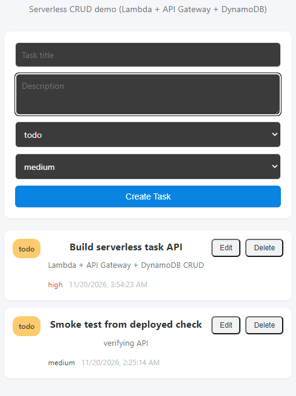
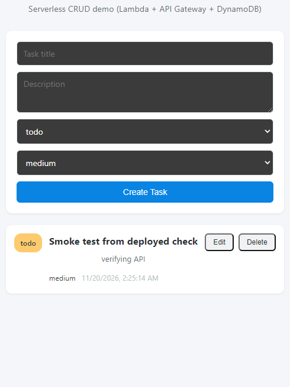
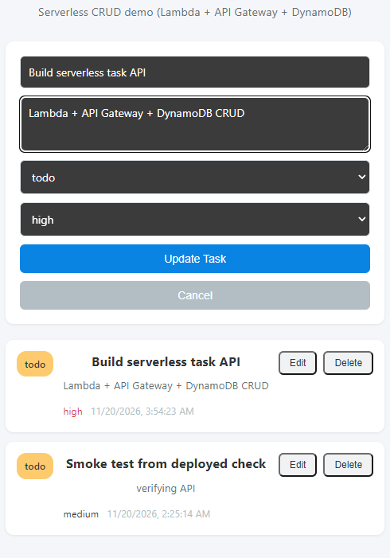
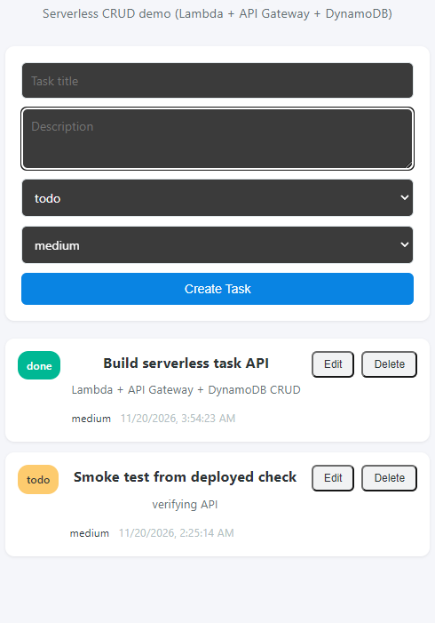
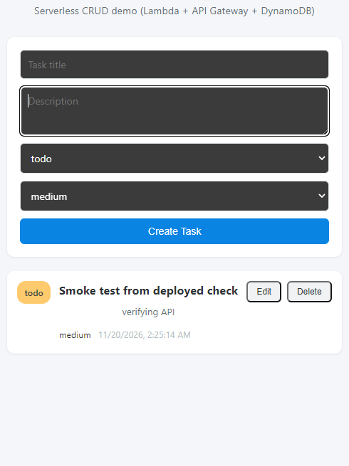
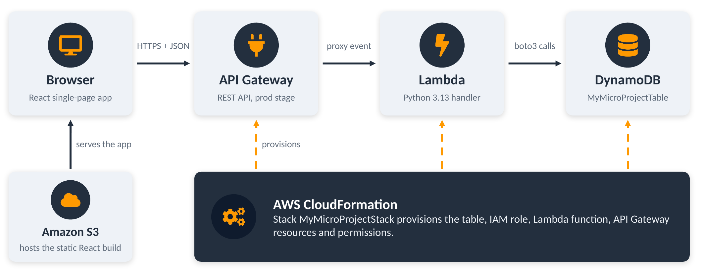

# Task Manager — Serverless Microproject

A full-stack task management application built with a **React + Vite** frontend and an **AWS serverless backend** (Lambda + API Gateway + DynamoDB), deployed entirely with CloudFormation.



## Live Demo

- **Frontend (deployed):** http://taskmanager-014566101772.s3-website-us-east-1.amazonaws.com/
- **API endpoint:** https://7kdibsbwkc.execute-api.us-east-1.amazonaws.com/prod/tasks

## Features

- Create, view, edit and delete tasks (full CRUD)
- Each task has a title, description, status (`todo`, `in-progress`, `done`) and priority (`low`, `medium`, `high`)
- One form handles both creating and editing
- Task list refreshes from the API after every change
- API errors are shown in the UI
- No servers to manage: Lambda, API Gateway and DynamoDB are all managed AWS services

## Screenshots

| Task list | Create a task |
|:---:|:---:|
|  |  |
| The app loads existing tasks with `GET /tasks` | `POST /tasks` adds the new task to the top of the list |

| Edit a task | After updating |
|:---:|:---:|
|  |  |
| **Edit** loads the task into the form | `PUT /tasks/{id}` saves the new status and priority |

| Delete a task |
|:---:|
|  |
| `DELETE /tasks/{id}` removes the task from DynamoDB |

## Architecture



The browser loads the React app from S3. The app calls API Gateway over HTTPS; API Gateway passes each request to a single Lambda function, which reads and writes DynamoDB using `boto3`. CloudFormation creates the whole backend from one template.

| Layer | Service | Details |
|---|---|---|
| Compute | AWS Lambda | `MyMicroProjectFunction`, Python 3.13, 256 MB, 15 s timeout |
| API | API Gateway | REST API `7kdibsbwkc`, REGIONAL, stage `prod`, CORS enabled |
| Database | DynamoDB | `MyMicroProjectTable`, PAY_PER_REQUEST, partition key `id` (String) |
| IaC | CloudFormation | Stack `MyMicroProjectStack` — creates the Lambda, role, API, and table together |
| Hosting | S3 | Static website hosting for the built React app |

## API

The API is a complete CRUD interface over tasks (title, description, status, priority).

| Method | Endpoint | Purpose | Success response |
|---|---|---|---|
| `POST` | `/tasks` | Create a task | `201 Created` |
| `GET` | `/tasks` | List all tasks, newest first | `200 OK` with `{ items, count }` |
| `GET` | `/tasks/{id}` | Get one task | `200 OK` or `404` |
| `PUT` | `/tasks/{id}` | Update a task | `200 OK` or `404` |
| `DELETE` | `/tasks/{id}` | Delete a task | `200 OK` with `{ id, deleted: true }` |

Other responses: `400` for an unsupported route and `500` with a JSON error for unexpected failures. All responses include `Access-Control-Allow-Origin: *`, so the frontend can call the API from any origin.

### Example

```bash
# create
curl -X POST https://7kdibsbwkc.execute-api.us-east-1.amazonaws.com/prod/tasks \
  -H "Content-Type: application/json" \
  -d '{"title":"Build serverless task API","description":"Lambda + DynamoDB CRUD","priority":"high"}'

# list
curl https://7kdibsbwkc.execute-api.us-east-1.amazonaws.com/prod/tasks
```

## Data Model

Each task is one DynamoDB item:

```json
{
  "id": "9b2f…-uuid",
  "title": "Build serverless task API",
  "description": "Lambda + DynamoDB CRUD",
  "status": "todo",
  "priority": "high",
  "createdAt": "2026-11-20T03:54:23Z",
  "updatedAt": "2026-11-20T03:54:23Z"
}
```

`id` is the partition key and is generated by the Lambda function (UUID v4). Missing fields default to `status: "todo"`, `priority: "medium"` and `title: "Untitled task"`.

## Project Structure

```
backend/
  template.json        # CloudFormation stack (Lambda + API Gateway + DynamoDB + IAM)
  lambda_function.py   # Request handler — CRUD routing + DynamoDB access
  lambda_function.zip  # Deployed function code
frontend/
  src/App.jsx          # React UI — create / read / update / delete tasks
  index.html, vite.config.js, package.json
docs/
  architecture.png     # Architecture diagram
  screenshots/         # App screenshots used in this README
```

## Run Locally

```bash
cd frontend
npm install
npm run dev          # http://localhost:5173
```

To preview the production build instead:

```bash
npm run build
npm run preview      # http://localhost:4173
```

The frontend calls the deployed API by default. To use your own backend, change the `API` constant at the top of `frontend/src/App.jsx`.

## Deploy

The backend is deployed as one CloudFormation stack (21 resources):

```bash
aws cloudformation deploy \
  --template-file backend/template.json \
  --stack-name MyMicroProjectStack \
  --capabilities CAPABILITY_IAM \
  --region us-east-1
```

Because the Lambda code is shipped inline in the template, update the function code with:

```bash
cd backend && zip -q lambda_function.zip lambda_function.py
aws lambda update-function-code \
  --function-name MyMicroProjectFunction \
  --zip-file fileb://lambda_function.zip \
  --region us-east-1
```

Build the frontend and upload it to the S3 bucket configured for static website hosting:

```bash
cd frontend
npm run build
aws s3 sync dist/ s3://taskmanager-014566101772 --delete
```

## Limitations and Future Work

- No authentication yet (could add Amazon Cognito and an API Gateway authorizer)
- `GET /tasks` uses a table `Scan`; a `Query` on an index with pagination would scale better
- CORS allows every origin and the S3 website endpoint is HTTP only (CloudFront would add HTTPS)
- Add input validation, unit tests and a CI/CD pipeline
